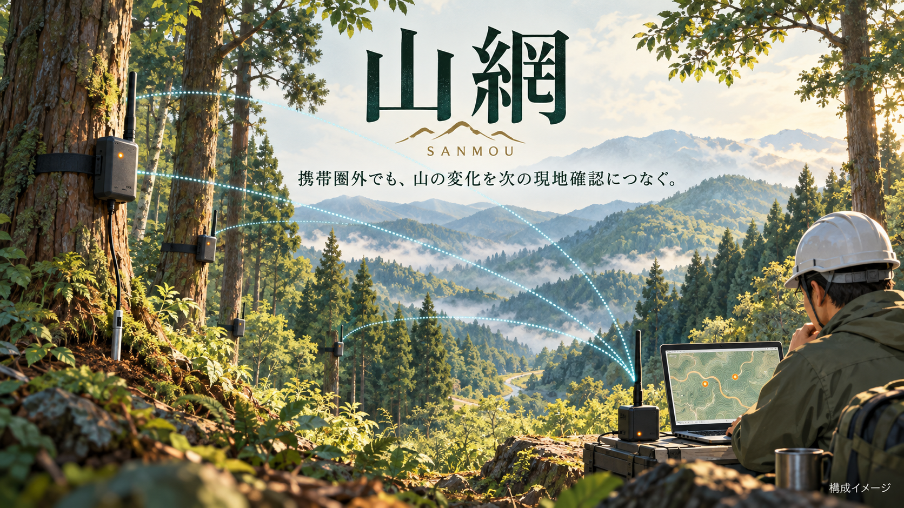
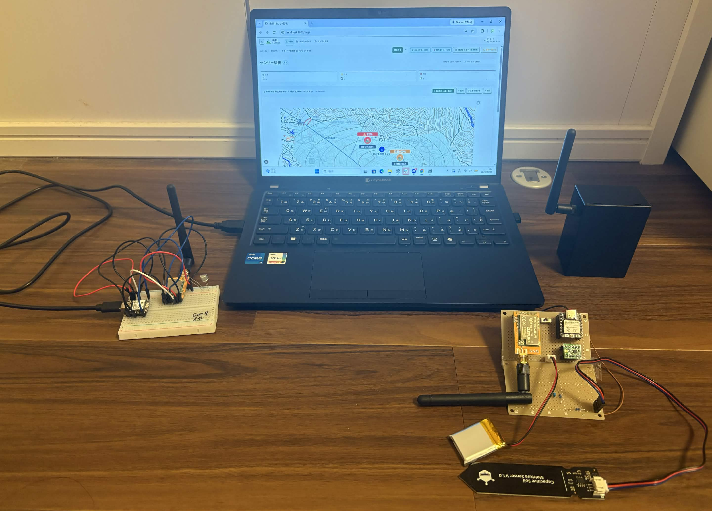
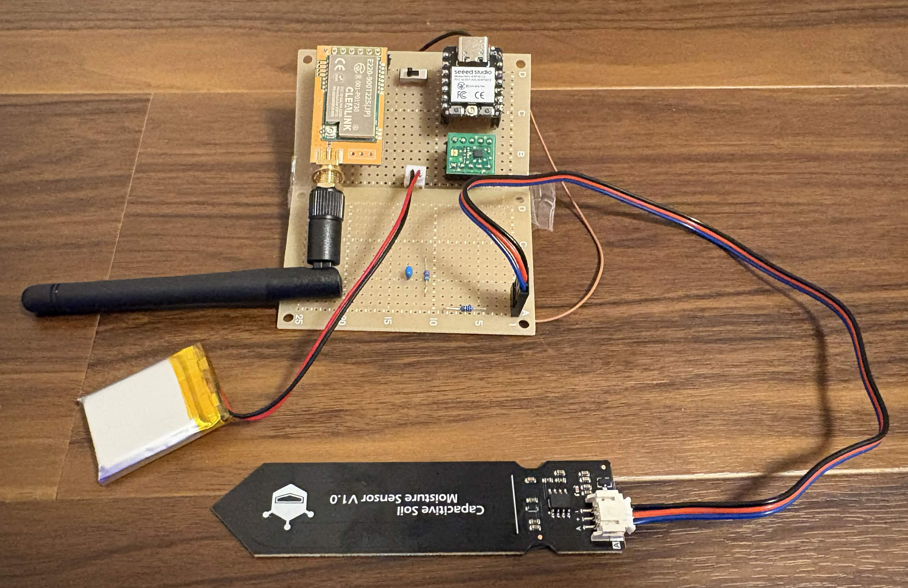
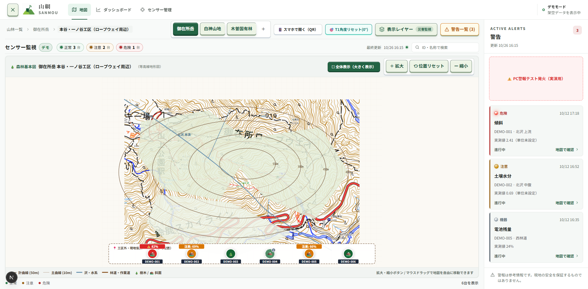
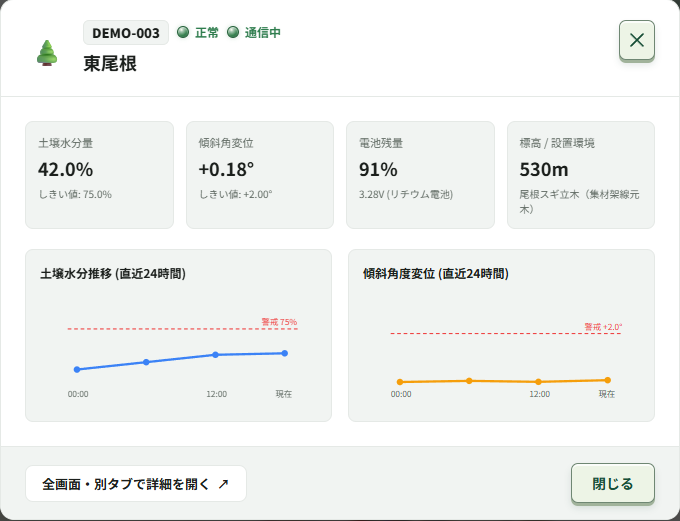
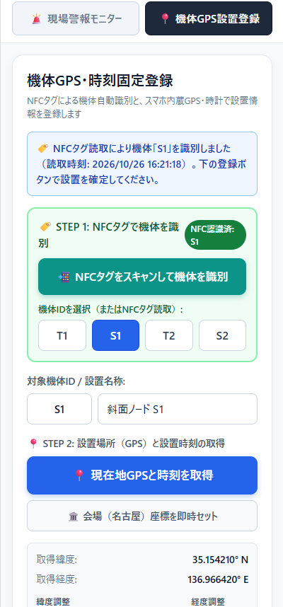

*AI生成の構成イメージです。実機・実測結果は以下の写真と検証記録を参照してください。*

# 山網 — SANMOU

### 携帯圏外でも、山の変化を次の現地確認につなぐ。

**山網は、森林組合・林業事業体の管理担当者が「今日、どこから現地確認に向かうか」を考えるための、山林観測・巡回支援システムです。**

山に設置したセンサーの情報をLoRaで集め、手元のPCで受信・保存・表示します。**中核処理は完全ローカル。クラウドへの常時接続を前提にせず、携帯圏外でも観測情報を扱う構成**です。

人が気になる場所を見つけ、センサーが巡回の間の変化を記録する。巡回をなくすのではなく、限られた人手を、確認が必要な場所に向けられるようにします。



*開発中の機器を並べた構成写真。PCの地図は模擬データによるデモ表示です。*

## 背景｜山が好きだから、見守る人を支えたい

私たちは山が好きです。登山中に倒木や荒れた道を見かけるたび、普段は人が通らない場所では、どんな変化が起きているのだろうと考えてきました。

森林の整備などを担う林業従事者は長期的に減少しており、2020年には約4万4千人となっています。この全国統計だけで個々の現場の人手不足を断定はできませんが、広い山林の状態を、人が移動して確認し続ける負担を技術で補えないかと考えました。[出典：林野庁「林業労働力の動向」](https://www.rinya.maff.go.jp/j/routai/doukou/index.html)

山林では、通信・電源・保守にも制約があります。センサーを置くだけでなく、携帯圏外でどう情報を集め、誰が設置・交換し、担当者が何を判断するのかまでつなげることが必要です。

## 利用場面｜雨や強風の後、どこから見に行くか

最初に想定する利用者は、森林組合・林業事業体の現場管理担当者です。たとえば、巡回中に継続して確認したい樹木や作業道沿いの地点を見つけたら、機体を設置し、場所と基準姿勢を登録します。

雨や強風の後の朝には、拠点や車載PCで姿勢の変化と最終受信時刻を確認します。変化した地点や情報が途絶えた地点を確認候補とし、現地の状況や既存の点検手順と合わせて、巡回順序を検討する使い方を目指しています。

**山網が提供するのは、現地確認を省く結論ではなく、次に確認する場所を考える材料です。**

## 写真と画面で見る山網

以下は、試作ハードウェアと開発中の画面例です。画面内の地名・数値・警告はデモ用であり、実機の測定結果や災害の検知実績を示すものではありません。

### 1. 観測する｜山の変化を、機体で捉える



*加速度センサーやLoRa通信モジュールを組み合わせた試作ノード。写真は土壌水分センサーを接続した状態です。実機受信の確認範囲は後述します。*

### 2. 場所と結び付ける｜どの地点の情報かを見る



地図上で機体の位置や状態を確認し、対象地点の詳細へ進む画面です。地形の下絵やレイヤーも扱い、観測値を「確認する場所」につなげます。正式な現地地図の利用には、出典・利用条件・位置精度の確認が必要です。

### 3. 変化を確認する｜値と履歴を合わせて見る



*個別地点の表示例。土壌水分率・電池残量・グラフ・警戒線はデモ表示です。実機では未計測項目を未計測として扱います。*

### 4. 現地で記録する｜機体と設置場所を対応付ける



スマホWeb画面で機体を識別し、座標や設置記録を扱います。対応環境ではNFC・端末位置情報を利用し、接続できない場合の設置情報は端末内の未同期キューに保存して、PCへ接続できたときに**手動で同期**する実装です。

*画像はPCブラウザのモバイル表示です。NFCの実読取やGPS実測の証拠ではありません。Web NFCや位置情報には対応端末・権限・HTTPS等の条件があり、端末内保存だけでスマホ画面のオフライン初回起動が可能になるわけではありません。*

## 特長・技術的な工夫

### 受信・保存・閲覧が、完全ローカルで完結する

センサーの情報は、LoRa受信機からUSBでPCへ取り込みます。観測ログや機体台帳を手元に保存し、PC上のWeb画面で閲覧するため、中核処理に外部クラウドや携帯回線を必須としません。

ここでいう完全ローカルは、**必要な依存ライブラリとローカル素材を準備した後の構成**です。初回セットアップ、オンライン地図、外部URLの下絵、更新は別の接続条件があります。また、LoRaは地形や樹木の影響を受け、スマホとの共有にはPCへ到達できるローカルWi-Fi等が必要です。

### ハード・PC・スマホに、適した役割を持たせる

機体は観測と送信、PCは保存・集約・表示、スマホは現地での識別と設置記録を担当します。機体ごとにGPSや時計を載せるのではなく、スマホで設置情報を補うことで、構成と運用負担を抑えることを目指しています。

設置記録時刻、機体の起動後経過時間、PCの受信時刻は別々に扱います。設置時刻を記録しただけで、各観測の絶対時刻まで確定したとはしません。

### 「情報がない」を「正常」にしない

デモ値と実機値、未計測と有効値、通信中と古いデータ、基準未設定と変化なしを区別する設計を重視しています。観測値の変化と機器・通信の状態を分け、判断の前提となる情報も見えるようにします。

### 受信処理と画面を分け、検証しやすくする

Python側でS0形式のパケットを解析し、起動ログや破損行と区別してCSVへ保存します。表示とは別に受信・保存を確認できる構成とし、機体IDを台帳と対応付けて履歴を追います。基準姿勢と警告は機体ごとに扱い、PCとスマホWeb画面で共有する試作を進めています。

## 技術構成

```text
センサーノード → LoRa → 受信機 → USBシリアル → 現場PC
                                               ├ Python：受信・形式検証
                                               ├ CSV：観測ログ
                                               ├ FastAPI / SQLite：API・台帳
                                               └ Next.js：地図・履歴・機体管理
スマホWeb画面 ← 許可されたローカルネットワーク → PC
    └ localStorage：未同期の設置情報／接続回復後に手動同期
```

| 担当 | 使用技術・実装 |
| --- | --- |
| 試作ハードウェア | XIAO ESP32C3、加速度センサー、E220シリーズのLoRaモジュール、土壌水分センサー |
| 受信・API | Python、pyserial、FastAPI、Pydantic |
| 保存 | CSV、SQLite、SQLAlchemy、Alembic。基準・警告は共有APIのローカルJSON保存処理 |
| PC・スマホ向け画面 | Next.js App Router、React、TypeScript、SVG、CSS Modules |
| 地図 | ローカルSVG・下絵、条件付きでGoogle Maps JavaScript API |
| 品質確認 | TypeScript、Vitest、ESLint、Prettier、pytest、Ruff、mypy |

スマホの現行実装は `/mobile` のWeb画面です。Flutterアプリ・BLE近接SOS・バックグラウンド自動同期は将来構想です。基準・警告のJSONはOSの一時領域に保存する実装であり、長期保管・同時更新・保存失敗からの復旧は継続検証します。

## 検証記録と現在の到達点

| 区分 | 確認できた内容 |
| --- | --- |
| 実機の受信記録 | T1のID付き3軸加速度を含む受信ログ9行（seq=0〜8）が共有されています。`sample_ms` の間隔は1500〜1506ms。これは機体の起動後時刻の差であり、通信遅延や取得率の測定ではありません。 |
| コード上の実装 | 受信・CSV保存、台帳、地図・グラフ、スマホWeb画面、機体別の基準姿勢と警告共有、設置情報キューと手動同期。コードの存在と実機の通し試験は区別します。 |
| 画面の確認 | 掲載した地図・詳細・登録画面は開発時の表示例です。デモの台数・数値・警告は実測実績ではありません。 |
| 未計測・継続検証 | 共有されたT1ログの土壌値・電池電圧は未計測。オフライン通し動作、基準設定から警告解除まで、スマホ実端末、長期保存・通信・電源、現場での巡回効果を検証します。 |

自動試験と実機・現場での検証を分け、結果には対象コミットと実行条件を添えて記録します。詳しい試験条件と記録様式は [検証・評価計画](https://github.com/jphacks/ng_2618/blob/main/docs/VALIDATION.md) を参照してください。

## 既存手段との役割分担

徒歩巡回は現地の細かな確認に、ドローンや衛星は上空・広域からの把握に強みがあります。山網は、それらを置き換えるのではなく、**管理者が指定した地点の変化を巡回の間も記録し、手元で確認する役割**を担います。

クラウド接続は遠隔共有に有用ですが、山網は現地PCでのローカル運用を中核にしています。森林向けLoRaネットワークにも [Dryad Silvanetなどの先行事例](https://www.dryad.net/meshgateway) があり、LoRa自体の新規性ではなく、少人数での巡回判断と設置・保守を含めた使いやすさを検証します。

低コスト化も重要な目標であり、試作1ノードあたりの部品原価は約¥6,150（XIAO ESP32C3、ADXL367、E220モジュール等）。中核処理の完全ローカルPC完結により**月額クラウド利用料・セルラーSIM通信料は0円**です。先行ソリューション（Dryad、SpreadRouter等）や代替手段との定量的コスト比較は [コスト構造と先行事例比較](https://github.com/jphacks/ng_2618/blob/main/docs/COST_ANALYSIS.md) に整理しています。
## 今後の展望

まず、森林管理の担当者へのヒアリングと小規模な設置試験を通じて、観測情報によって確認候補を選びやすくなるかを確かめます。判断にかかる時間だけでなく、設置・交換・誤警告への対応も記録し、追加された負担に見合うかを評価します。

その後、土壌センサーの校正、電池電圧・消費電力・通信到達性を確認し、多数ノードを扱う表示・無線容量・保守の評価へ進みます。**一人の管理者が数百、数千の観測地点から確認候補を絞り込める状態**は将来目標であり、現在の運用実績ではありません。独立アプリ化や海外での適用可能性などは [今後の課題](https://github.com/jphacks/ng_2618/blob/main/FUTURE_WORK.md) に整理します。

山が好きだからこそ、山を見守る人が、これからも管理を続けられるように。山網は、その判断を支える道具を目指します。

## 起動方法

<details>
<summary>動作環境・デモ起動・実機接続の手順を開く</summary>

### 事前準備

Node.js / npmとPython 3.11以上を用意し、リポジトリを取得してください。Node.jsの許容版は `frontend/package.json` の `engines` を確認してください。

初回は依存ライブラリ取得のため通常インターネット接続が必要です。圏外へ持ち出す前にセットアップを済ませ、使用するPC・ローカル素材で起動を確認してください。

### 機器なしでデモ画面を見る

Windowsではリポジトリルートの `start_demo.bat` を実行します。

```powershell
.\start_demo.bat
```

macOS / Linuxでは次を実行します。

```bash
bash start_demo.sh
```

ブラウザで `http://localhost:3000/map` が開きます。デモ起動は新しい無線受信の確認ではありません。

### 実機を接続する

受信機をUSB接続し、Windowsでは次を実行してCOMポートを入力します。同じポートを使うシリアルモニターは閉じてください。

```powershell
.\start.bat
```

macOS / Linuxでは次を実行し、接続したUSBシリアルポートを指定します。

```bash
bash start.sh
```

受信・API・画面が起動し、`http://localhost:3000/dashboard` で観測履歴を確認できます。

### スマホと共有する

既定ではPC自身からのみ接続できます。信頼できるLANでスマホ接続を許可する場合は、明示的にLAN待受を有効にします。たとえば、実機受信を行う場合：

```bash
python scripts/run_test_environment.py --port COM3 --allow-lan
```

`COM3` は実際のポートに置き換えてください。スマホでは `localhost` ではなくPCのLANアドレスを使います。ファイアウォール・操作権限・端末権限等を確認し、開発サーバーを公開インターネットへ露出しないでください。

終了は起動元で `Ctrl + C` を押し、プロセスが停止したことを確認してください。詳細なセットアップ・テスト手順は [README_build.md](https://github.com/jphacks/ng_2618/blob/main/README_build.md) を参照してください。

</details>

## 関連資料

[利用場面](https://github.com/jphacks/ng_2618/blob/main/docs/USE_CASES.md) ／ [システム構成](https://github.com/jphacks/ng_2618/blob/main/docs/ARCHITECTURE.md) ／ [コスト構造と先行事例比較](https://github.com/jphacks/ng_2618/blob/main/docs/COST_ANALYSIS.md) ／ [検証・評価計画](https://github.com/jphacks/ng_2618/blob/main/docs/VALIDATION.md) ／ [実証実験プロトコル](https://github.com/jphacks/ng_2618/blob/main/docs/FIELD_TRIAL_PROTOCOL.md) ／ [今後の課題](https://github.com/jphacks/ng_2618/blob/main/FUTURE_WORK.md)

> 山網は開発中の試作システムです。観測値・警告は現地確認の参考情報であり、倒木・土砂災害の予測や安全を保証するものではありません。
