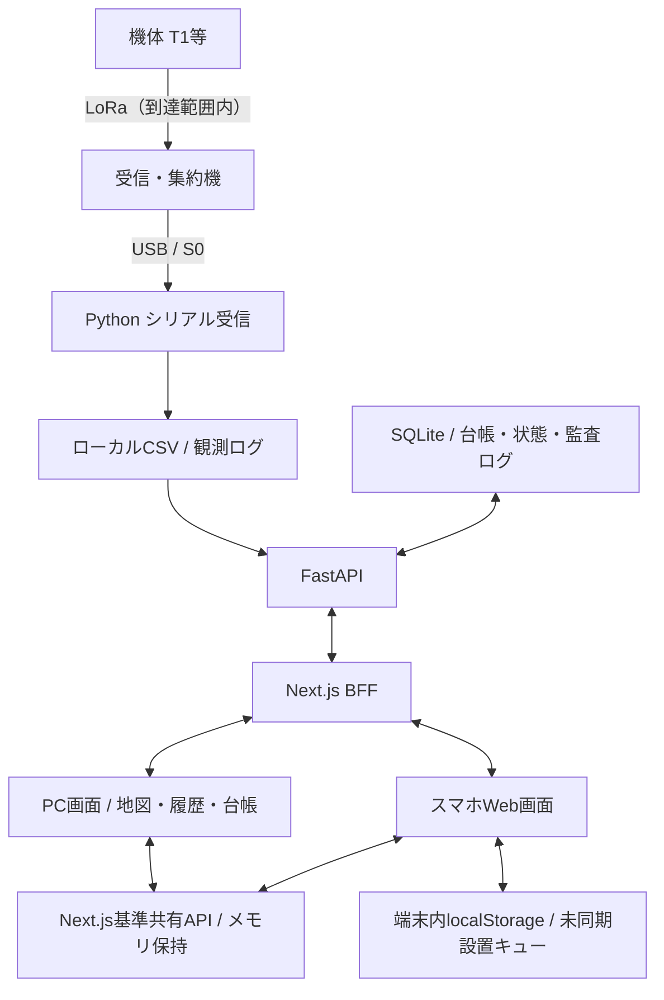
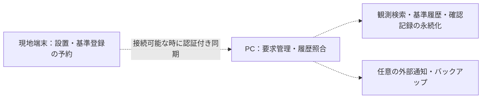

# ARCHITECTURE.md — ローカル完結の構成と実装境界

文書版：2.1 / 2026-10-26

## 1. 設計目的と「適材適所」

限られた人手で広い山林を把握するため、機体の観測と設置情報を集め、巡回・現地確認の判断材料にする。携帯圏外や電源・設置の制約を前提とし、中核の受信・保存・閲覧を手元のPCで行う。

機体は観測・送信、PCは保存・集約・表示、スマホは現地の識別・設置記録を担当する。PythonとWebの分離は開発・検証・責務分離のための選定であり、他技術で実現不可能という意味ではない。

## 2. 現在のコードにある構成

この図はコードの所在を示す。全経路の通し動作、長期稼働、再起動耐性を実証済みとする図ではない。実機記録・コード確認・今後の試験は [VALIDATION.md](VALIDATION.md) に分ける。

### 2.1 保存先の違い

| 保存先             | 現在扱うデータ                       | 限界                                                             |
| ------------------ | ------------------------------------ | ---------------------------------------------------------------- |
| CSV                | 受信観測、PC受信日時、元レコード     | 台帳DBとは別。大規模・長期の検索性能は評価が必要                 |
| SQLite             | 機体台帳、状態、変更監査、山林情報等 | 観測・基準・全警告の永続DBを完成済みとはしない                   |
| Next.jsメモリ      | 機体別の基準ベクトル、共有警告       | サーバー再起動後の保持を保証しない                               |
| スマホlocalStorage | 送信に失敗した設置情報のキュー       | ブラウザ削除・容量・保存失敗があり得る。画面のオフライン起動は別 |

### 2.2 Pythonの受信・API

USBの改行フレームを分け、S0を検証し、起動ログや破損行を区別してCSVへ追記する。FastAPIはCSV観測とSQLite台帳等を提供する。USB切断時の再接続・プロセス復旧は試験対象とし、決して停止しないとは記載しない。

現在の観測取得には末尾読込の最適化があるが、特定機体の絞り込み等を含め、大量履歴での性能保証ではない。台帳と最新観測一覧、機体別履歴を分けて評価する。

### 2.3 Next.js・PC画面

React / SVGの地図・グラフとBFFを提供する。`/api/test-sensors` 等はサーバー間トークンを付けてFastAPIへ接続する。一方、基準共有の `/api/test-baseline` はNext.js内のメモリAPIであり、FastAPI / SQLiteへの永続化ではない。

Google Mapsや外部URLの下絵を使う場合は回線等の条件がある。ローカルSVG表示と、正式な現地地図のオフライン配信を分ける。

### 2.4 スマホWeb画面

現在の本リポジトリには `/mobile` があり、機体選択・NFC用URL・対応環境でのWeb NFC・位置登録・基準共有・未同期設置キュー・手動再送が実装されている。Flutterソースの所在は本リポジトリでは確認できていない。

Web NFC非対応時の手動代替を読取成功としない。位置取得失敗時の会場座標・仮精度を測量結果としない。設置時刻を端末内に記録する処理があっても、PCへ送る台帳のフィールドや永続性は別に確認する。

## 3. オフラインの範囲と接続条件

| 場面                         | 必要なもの                                           | 外部インターネット                                 |
| ---------------------------- | ---------------------------------------------------- | -------------------------------------------------- |
| PC単独で受信・保存・閲覧     | セットアップ済みPC、電源、機体・受信機、ローカル素材 | 中核処理には不要という設計                         |
| スマホからPCへ登録・共有     | PCへ到達するローカルWi-Fi等、待受・認証・端末権限    | 外部回線は必須にしない                             |
| PCにつながらない現場のスマホ | 事前準備したオフライン起動画面または将来の独立アプリ | 不要にする目標。localStorage実装だけでは成立しない |
| 初回依存導入・外部地図・更新 | 配布物または各サービスへの接続                       | 別途条件あり                                       |
| メール・外部プッシュ         | 通知サービスと到達可能な経路                         | 外部通信が必要な別機能                             |

「携帯電波がない」と「LoRaやローカルWi-Fiも使えない」は異なる。PCとスマホの通信は同一LANでも隔離・ファイアウォール・アドレス解決等に左右される。mDNS名の使用だけで接続を保証しない。

## 4. 後続の構成・要求

破線は将来の設計・評価項目で、現時点の動作確認を示さない。

- **操作時刻を基準にする登録**：シェイク等の操作日時に対応する観測を後から探す。現在の「最新値を基準にする」APIとは別。
- **履歴なし時の選択**：自動置換せず、利用者が現在値登録を選べる。元の操作時刻と採用観測時刻を分ける。
- **時刻**：sample_msは起動後時刻。設置日時を記録しても、各観測の測定日時は確定しない。時計ずれ・受信遅延・再起動を扱う。
- **独立アプリ配布**：PC・スマホのスタンドアロン化は将来目標。ローカルWebも外部回線なしで動作できるため、ネイティブ化が唯一のオフライン手段とは説明しない。
- **多数ノード・中継**：通信容量、重複、再起動、検索、保守を評価する。数百〜数千ノードは目標であり、実証済みではない。
- **通知**：近接SOS・ウェアラブル・外部メールを、到達性と運用を確認する別機能として扱う。

## 5. 技術選定と運用条件

Python / pyserialは機体の受信処理、FastAPI / SQLAlchemyはAPIとローカル台帳、React / SVGは地図とグラフの実装に用いる。UIと受信を別プロセスに分け、単体での検証をしやすくする。

Python GUIや他のシリアルライブラリが一律に動作不能・必ず取りこぼす等とはしない。採用技術の性能・OS間の互換性も、実行条件を記録して試験する。

Windows / macOSを主対象とし、ポートやパスを設定で扱う。実際に試したOS・端末・版を [VALIDATION.md](VALIDATION.md) の形式で記録する。

## 6. セキュリティとデータ境界

- サーバー間トークンの秘匿は、ブラウザ利用者の認証とは別。`/api/test-baseline` 等も含め、LAN共有時の権限と入力検証を評価する。
- CORSだけでネットワーク上の全アクセスを防げるとは扱わない。待受、ファイアウォール、許可端末、認証を分ける。
- 単独PC運用とスマホ共有運用の接続範囲を明示する。現在の起動設定を安全な本番公開設定としない。
- 土壌・電池の-1は未計測、負の加速度は有効値。全軸ゼロは姿勢基準として不適切。
- デモ、実機テスト、本番、仮座標、会場プリセット、手動操作を区別する。

参考：[要件](REQUIREMENTS.md)、[API](API_SPEC.md)、[設計判断](DECISIONS.md)、[検証計画](VALIDATION.md)。
