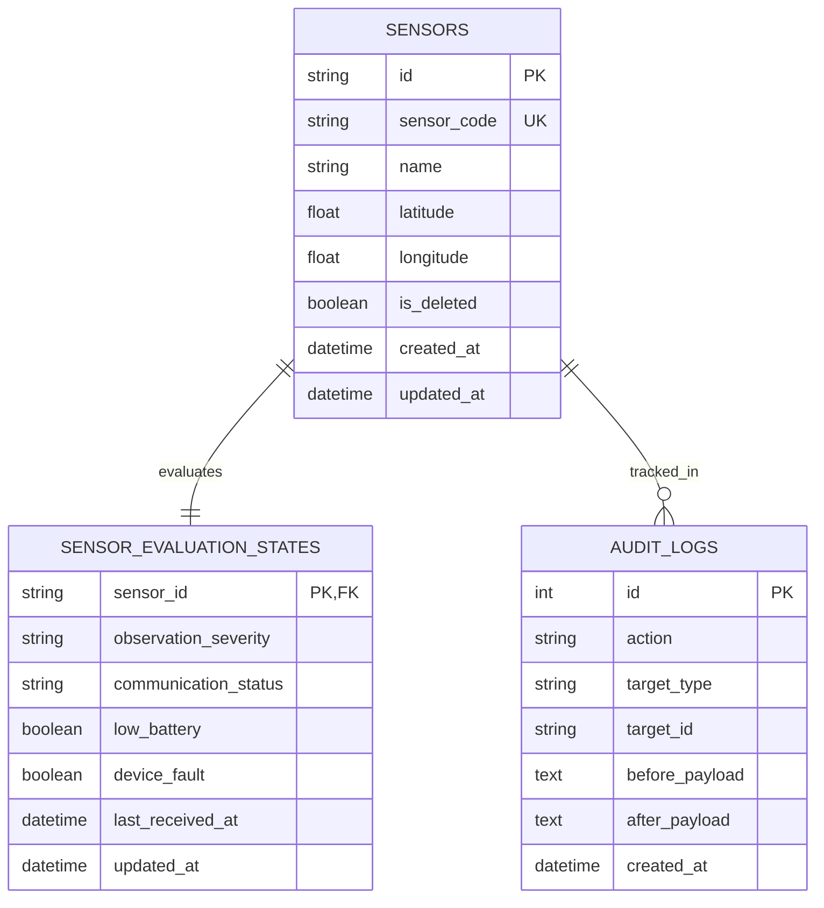

# DATABASE.md — データベース仕様書（SQLite & 将来構想）

> 文書版: 2.0 / 2026-10-24  
> 対象: JPHACKS / SQLite (実証・オフライン用) + SQLAlchemy 2.0 + Alembic

---

## 1. データベース方針

- **検証・オフライン用エンジン**: **SQLite 3**（`backend/data/sanmou-test.sqlite3`）
  - 外部DBサーバーの起動が不要で、山林現場のノートPC単体で稼働可能なファイルベースDB。
  - SQLAlchemy 2.0 によるORM定義と、Alembicによるマイグレーション管理を適用。
  - スレッド間共有設定: `connect_args={"check_same_thread": False}`。
- **時刻管理**: すべて UTC の `TIMESTAMP` として保存。
- **削除方針**: センサーおよび関連データは**論理削除**（`is_deleted = true`）を基本とし、過去の観測・監査記録を物理削除しない。

---

## 2. 実装済みテーブル定義（実証用SQLite）

### 2.1 `sensors`（センサー台帳テーブル）
| カラム名 | 型 | NULL | 初期値 | 説明 |
|---|---|---|---|---|
| `id` | VARCHAR(36) | NO | UUIDv4 | 内部主キー（一意識別子） |
| `sensor_code` | VARCHAR(64) | NO | - | UI表示・検索用コード（大文字小文字区別なしUNIQUE） |
| `name` | VARCHAR(128) | NO | - | センサー名称 |
| `latitude` | FLOAT | NO | - | 設置緯度（-90.0 〜 90.0） |
| `longitude` | FLOAT | NO | - | 設置経度（-180.0 〜 180.0） |
| `installed_at` | TIMESTAMP | YES | `NULL` | 現場設置確定日時（ISO 8601 UTC） |
| `position_accuracy_m` | FLOAT | YES | `NULL` | 測位精度（メートル、未取得時 NULL） |
| `identity_method` | VARCHAR(32) | YES | `NULL` | 機体識別方法（`web_nfc`, `url`, `manual`） |
| `position_method` | VARCHAR(32) | YES | `NULL` | 測位方法（`gps`, `manual`, `demo_preset`） |
| `is_deleted` | BOOLEAN | NO | `false` | 論理削除フラグ |
| `created_at` | TIMESTAMP | NO | 現在UTC | 登録日時 |
| `updated_at` | TIMESTAMP | NO | 現在UTC | 更新日時 |
### 2.2 `sensor_evaluation_states`（センサー判定状態テーブル）
センサーの観測重要度と機器状態を独立して保持するテーブル（`sensors` と 1:1 紐付け）。

| カラム名 | 型 | NULL | 初期値 | 説明 |
|---|---|---|---|---|
| `sensor_id` | VARCHAR(36) | NO | FK | 対象センサーID（主キー） |
| `observation_severity` | VARCHAR(16) | NO | `'unknown'` | 観測重要度（`normal`, `caution`, `danger`, `unknown`） |
| `communication_status` | VARCHAR(16) | NO | `'unknown'` | 通信状態（`online`, `offline`, `unknown`） |
| `low_battery` | BOOLEAN | YES | `NULL` | 低電池状態（`true` / `false` / `NULL:未判定`） |
| `device_fault` | BOOLEAN | YES | `NULL` | 故障状態（`true` / `false` / `NULL:未判定`） |
| `last_received_at` | TIMESTAMP | YES | `NULL` | サーバー最終受信日時 |
| `updated_at` | TIMESTAMP | NO | 現在UTC | 判定更新日時 |

### 2.3 `audit_logs`（変更監査ログテーブル）
台帳の新規登録や座標変更の前後差分を追跡記録するテーブル。

| カラム名 | 型 | NULL | 初期値 | 説明 |
|---|---|---|---|---|
| `id` | INTEGER | NO | AUTO_INCREMENT | 監査ログ連番主キー |
| `action` | VARCHAR(32) | NO | - | 操作種別（`create`, `update` 等） |
| `target_type` | VARCHAR(32) | NO | `'sensor'` | 対象エンティティ名 |
| `target_id` | VARCHAR(36) | NO | - | 対象エンティティのID |
| `before_payload` | TEXT | YES | `NULL` | 変更前のJSON表現 |
| `after_payload` | TEXT | NO | - | 変更後のJSON表現 |
| `created_at` | TIMESTAMP | NO | 現在UTC | 操作日時 |

### 2.4 `installations`（設置履歴テーブル、Issue #59）
機体の物理設置単位を管理し、再設置時の履歴保持と新旧分離を行うテーブル。

| カラム名 | 型 | NULL | 初期値 | 説明 |
|---|---|---|---|---|
| `id` | VARCHAR(36) | NO | UUIDv4 | 内部主キー |
| `installation_id` | VARCHAR(80) | NO | - | 機体設置識別子（UNIQUE） |
| `node_id` | VARCHAR(80) | NO | - | 機体ID（`sensors.sensor_code` と対応） |
| `request_id` | VARCHAR(36) | NO | - | 初回確定要求ID |
| `installed_at` | TIMESTAMP | NO | - | 現場作業日時（UTC） |
| `latitude` | FLOAT | NO | - | 設置緯度 |
| `longitude` | FLOAT | NO | - | 設置経度 |
| `position_accuracy_m` | FLOAT | YES | `NULL` | 測位精度（メートル） |
| `identity_method` | VARCHAR(32) | YES | `NULL` | 機体識別方法（`web_nfc`, `url`, `manual`） |
| `position_method` | VARCHAR(32) | YES | `NULL` | 測位方法（`gps`, `manual`） |
| `status` | VARCHAR(32) | NO | `'active'` | 設置状態（`active`, `superseded`, `cancelled`） |
| `version` | INTEGER | NO | 1 | 設置世代番号 |
| `created_at` | TIMESTAMP | NO | 現在UTC | 登録日時 |

### 2.5 `captures`（静止基準取得結果テーブル、Issue #53, #54, #59）
機体が静止区間でサンプリングし、BLE経由で持ち帰った基準姿勢レコード（不変）。

| カラム名 | 型 | NULL | 初期値 | 説明 |
|---|---|---|---|---|
| `id` | VARCHAR(36) | NO | UUIDv4 | 内部主キー |
| `capture_id` | VARCHAR(80) | NO | - | 機体基準取得識別子（UNIQUE） |
| `installation_id` | VARCHAR(80) | NO | FK | 紐づく設置識別子 |
| `node_id` | VARCHAR(80) | NO | - | 機体ID |
| `baseline_ax_mg` | INTEGER | NO | - | 基準X軸加速度（mg） |
| `baseline_ay_mg` | INTEGER | NO | - | 基準Y軸加速度（mg） |
| `baseline_az_mg` | INTEGER | NO | - | 基準Z軸加速度（mg） |
| `variance_mg2` | INTEGER | NO | 0 | 取得区間加速度分散（静止品質評価用） |
| `sample_count` | INTEGER | NO | 20 | 取得サンプル数 |
| `duration_ms` | INTEGER | NO | 2000 | 取得所要時間（ミリ秒） |
| `quality` | VARCHAR(32) | NO | `'good'` | 取得品質（`good`, `acceptable`, `rejected`） |
| `config_version` | INTEGER | NO | 1 | 測定設定・フィルター版 |
| `created_at` | TIMESTAMP | NO | 現在UTC | 登録日時 |

### 2.6 `sync_request_logs`（冪等同期要求ログテーブル、Issue #59）
同一 `request_id` の二重送信検知・冪等返却・競合判定を管理するテーブル。

| カラム名 | 型 | NULL | 初期値 | 説明 |
|---|---|---|---|---|
| `request_id` | VARCHAR(36) | NO | 主キー | クライアント発行UUIDv4 |
| `node_id` | VARCHAR(80) | NO | - | 機体ID |
| `payload_hash` | VARCHAR(64) | NO | - | 受信ペイロードSHA-256ハッシュ |
| `status_code` | INTEGER | NO | 200 | 返却HTTPステータスコード |
| `response_body` | TEXT | NO | - | クライアントへ返却したJSON応答 |
| `created_at` | TIMESTAMP | NO | 現在UTC | 初回要求受信日時 |

### 2.7 `alert_events`（姿勢変化・警報履歴テーブル、Issue #61）
PC常駐判定エンジンが検知した傾き変化・復帰・消音の履歴を永続化するテーブル。

| カラム名 | 型 | NULL | 初期値 | 説明 |
|---|---|---|---|---|
| `id` | VARCHAR(36) | NO | UUIDv4 | 内部主キー |
| `node_id` | VARCHAR(80) | NO | - | 機体ID |
| `installation_id` | VARCHAR(80) | NO | - | 判定対象設置ID |
| `capture_id` | VARCHAR(80) | NO | - | 参照した基準ID |
| `tilt_degrees` | FLOAT | NO | - | 基準からの傾斜角変化（度） |
| `severity` | VARCHAR(16) | NO | `'caution'` | 警報種別（`caution`, `danger`, `cleared`） |
| `status` | VARCHAR(16) | NO | `'active'` | 状態（`active`, `acknowledged`, `cleared`） |
| `reason` | VARCHAR(255) | NO | - | 判定理由（しきい値超過、継続時間等） |
| `triggered_at` | TIMESTAMP | NO | 現在UTC | 発生検知日時 |
| `resolved_at` | TIMESTAMP | YES | `NULL` | 解除日時 |

---

## 3. ER図（実証用SQLite）



---

## 4. マイグレーション管理（Alembic）

スキーマ変更はすべて Alembic マイグレーションスクリプトとしてバージョン管理します。

```bash
# マイグレーション適用
alembic upgrade head

# 新規マイグレーション作成（モデル変更時）
alembic revision --autogenerate -m "add_new_table"
```
